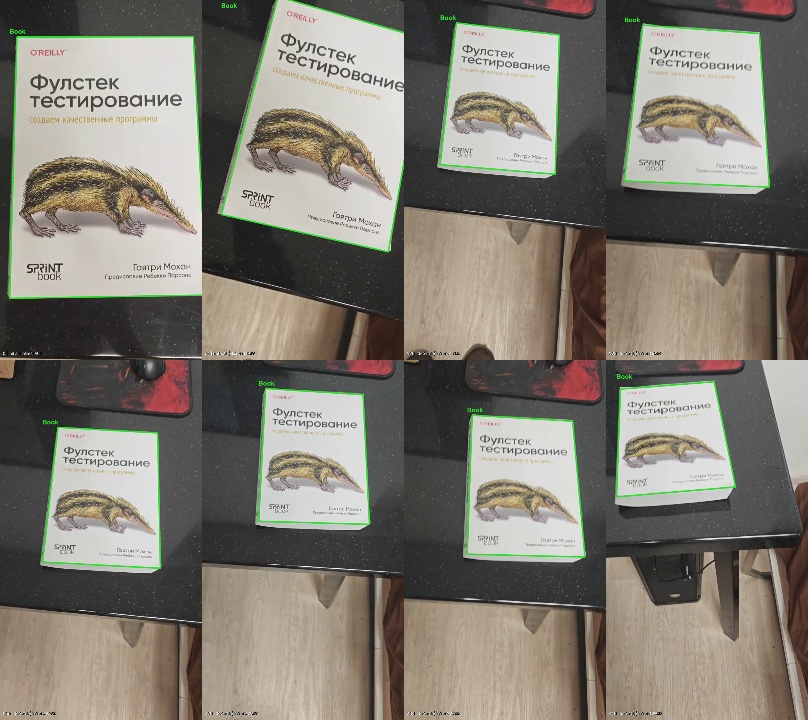

# Лабораторная работа №2

Трекинг объекта на видео по ключевым точкам. Для проверки использовано своё видео с книгой: камера отдаляется и меняет ракурс, а программа находит обложку и рисует вокруг неё рамку с подписью.

## 1. Теоретическая база

Ключевые точки — заметные детали изображения, которые можно найти повторно: углы, буквы и части рисунка. В работе используется SIFT. Для каждой точки он вычисляет дескриптор — числовое описание её окрестности.

Сравнивая дескрипторы первого и текущего кадров, можно найти одинаковые участки объекта. Неоднозначные совпадения отбрасываются, а по оставшимся с помощью RANSAC вычисляется гомография. Это преобразование позволяет перенести четыре угла обложки с учётом поворота, масштаба и перспективы.

Если совпадений с первым кадром мало, используется оптический поток Lucas–Kanade: он отслеживает движение точек между кадрами. Такой способ может накапливать ошибку, поэтому программа каждый раз сначала пробует заново найти объект по SIFT.

## 2. Описание разработанной системы

Программа написана на Python с использованием OpenCV и NumPy.

- `tracker.py` — поиск ключевых точек, сопоставление, расчёт гомографии и отслеживание точек.
- `main.py` — чтение видео, передача кадров трекеру, отрисовка рамки и сохранение результата.
- `run.ps1` — запуск на Windows с готовыми координатами моей книги.

На первом кадре задаются четыре угла обложки. Это нужно, чтобы искать признаки на книге, а не на столе. В `PlanarTracker.__init__` создаётся маска объекта и сохраняются его точки в трёх масштабах — это помогает находить книгу после отдаления камеры.

Метод `detect` сопоставляет признаки с текущим кадром. Для каждой точки выбираются два ближайших дескриптора; совпадение принимается, если расстояние до первого меньше 0,75 расстояния до второго. Метод `estimate` вычисляет гомографию и проверяет количество согласованных точек и форму рамки.

Если прямой поиск не удался, `follow` пробует оптический поток. Метод `update` выбирает результат: `detect` — объект найден по признакам, `flow` — положение обновлено по движению точек, `lost` — надёжной оценки нет. При потере старая рамка не показывается как текущее положение объекта.

В `main.py` четыре исходных угла переносятся в текущий кадр, соединяются линиями и подписываются `Book`. Обработанное видео и статистика сохраняются в `results`.

## 3. Результаты работы и тестирования системы

Для проверки записано видео книги «Фулстек тестирование». Текст и рисунок на обложке дают достаточно ключевых точек. Первый кадр показывает книгу крупно, затем меняются расстояние и угол съёмки.

| Параметр | Результат |
|---|---:|
| Размер видео | 720×1280 |
| Продолжительность | около 15 секунд |
| Обработано кадров | 449 |
| Первый кадр с заданной рамкой | 1 |
| Найдено по SIFT на следующих кадрах | 448 |
| Потерь объекта | 0 |

На этой записи резервный оптический поток не понадобился. Рамка следует за обложкой при отдалении и изменении ракурса. Это не означает идеального совпадения с границами на каждом кадре: книга имеет толщину, а алгоритм описывает только плоскость передней обложки.



[Исходное видео](data/my_video.mp4) · [Видео с рамкой](results/my_video_tracked.mp4) · [Статистика](results/my_video_stats.json)

В этом репозитории оставлен эксперимент со своим видео. Три отдельных варианта тестового видео здесь не представлены.

## 4. Выводы по работе

Получилось реализовать отслеживание книги по ключевым точкам. Гомография позволяет рамке менять размер и наклон вместе с обложкой. На своём видео объект найден на всех кадрах после инициализации.

Метод лучше работает с плоскими предметами, на которых есть текст или рисунок. Сильное размытие, блики, перекрытие и слишком маленький размер объекта могут привести к потере или смещению рамки.

## 5. Использованные источники

- [OpenCV: SIFT](https://docs.opencv.org/4.13.0/da/df5/tutorial_py_sift_intro.html).
- [OpenCV: сопоставление признаков и гомография](https://docs.opencv.org/4.13.0/d1/de0/tutorial_py_feature_homography.html).
- [OpenCV: оптический поток](https://docs.opencv.org/4.13.0/d4/dee/tutorial_optical_flow.html).
- [CV_course/lab2](https://github.com/skadibtw/CV_course/tree/69f1251b3d0f986badcde2ce7ad74a137fc99779/lab2) — использован как прототип SIFT и оптического потока; код переработан под эту работу.
- [SKOI_LAB2](https://github.com/programmer1276/SKOI_LAB2) — рассмотрен как пример другого подхода с ORB.

## Запуск

Из папки проекта в PowerShell:

```powershell
py -3.12 -m venv .venv
.\.venv\Scripts\python.exe -m pip install -r requirements.txt
.\.venv\Scripts\python.exe main.py data/my_video.mp4 --label Book --quad 60 131 687 130 734 1049 34 1060 --show
```

Координаты углов подобраны для первого кадра моего видео; правый нижний угол немного выходит за кадр. Для другого видео можно выбрать объект мышью:

```powershell
.\.venv\Scripts\python.exe main.py "C:\Videos\video.mp4" --select --label Object --show
```

Без `--show` обработка идёт без окна. Esc завершает её досрочно. Для сохранения в H.264 нужен FFmpeg в PATH; без него программа сохраняет MP4V. Результат записывается без звука, исходное видео не меняется.
