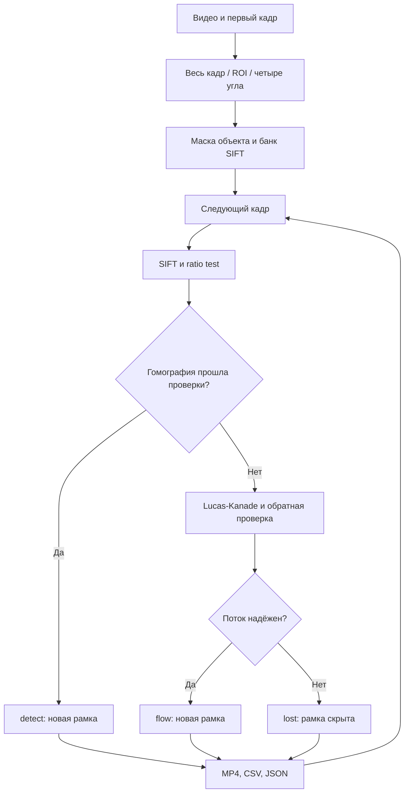
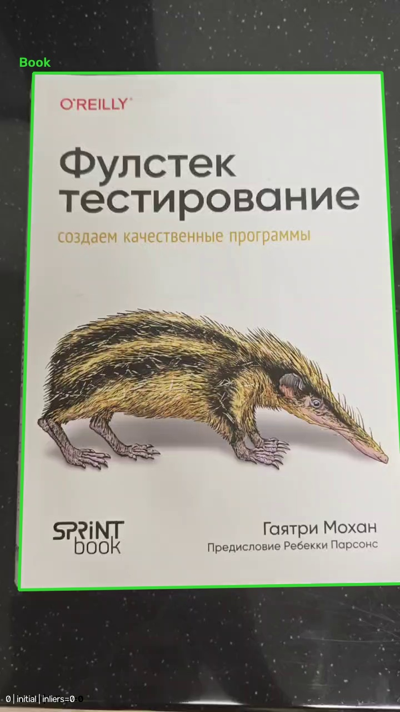
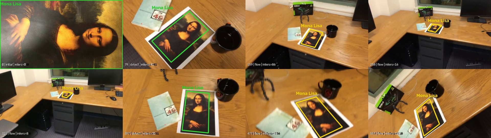
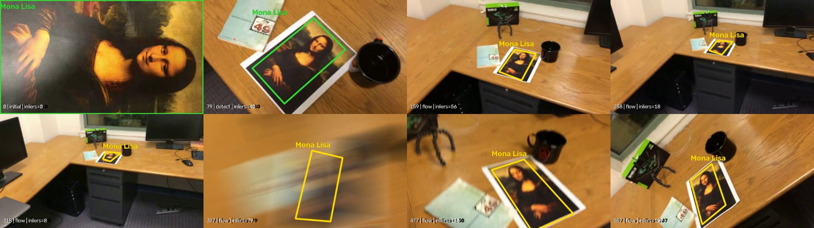
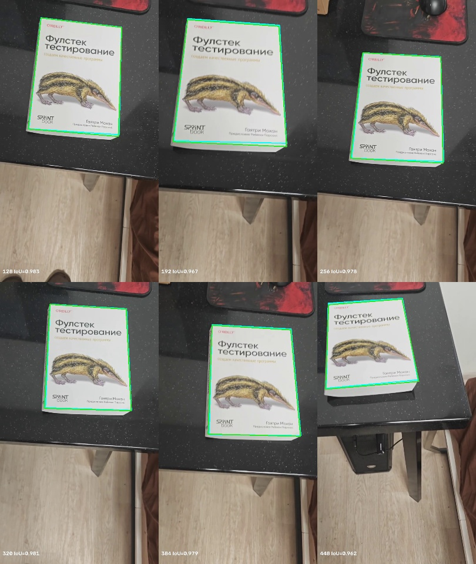

# Лабораторная работа №2. Трекинг объекта по ключевым точкам

**Задача:** по крупному изображению объекта на первом кадре находить тот же объект на следующих кадрах и рисовать подписанную рамку, учитывающую поворот, масштаб и перспективу. Рассматривается текстурный плоский прямоугольный объект.

Реализация на Python: **SIFT → сопоставление дескрипторов → RANSAC-гомография**, с резервным слежением **Lucas–Kanade**. Нейросети и предварительное обучение не используются.

В репозитории находятся исходный код, три варианта тестового видео, собственная запись с книгой, обработанные MP4, примеры кадров и фактические метрики. Проверка выполнена 13 ноября 2026 года. Прототип алгоритма и тестовые материалы взяты из [CV_course/lab2](https://github.com/skadibtw/CV_course/tree/69f1251b3d0f986badcde2ce7ad74a137fc99779/lab2); переработка описана ниже, происхождение материалов — в [SOURCES.md](SOURCES.md).

**Результат на собственном видео:** обработаны 449 кадров; после ручной инициализации положение книги заново определено на всех 448 последующих кадрах. Средний IoU на шести отдельно размеченных контрольных кадрах — **0,9749**. Это выборочная оценка, а не утверждение об идеальной точности на всём видео.

[Собственное видео](data/my_video.mp4) · [Видео с рамкой](results/my_video_tracked.mp4) · [Покадровые координаты](results/my_video_frames.csv) · [Метрики](results/my_video_stats.json)


## 1. Теоретическая база

### 1.1. Постановка задачи

Дан видеопоток $I_0, I_1, \dots, I_n$ и область объекта на первом кадре. Требуется оценивать его четыре угла на каждом следующем кадре. Если первый кадр содержит фон, область задаётся отдельно: фоновые признаки не должны становиться частью эталона.

Четырёхугольная рамка предпочтительнее горизонтального прямоугольника: при наклоне камеры видимый прямоугольный объект превращается в перспективный четырёхугольник. Предполагается, что видимая поверхность достаточно плоская, а её текстура сохраняется при движении.

Ключевые точки удобны для обложек, плакатов и упаковок с текстом и рисунками. На однотонной, бликующей или размытой поверхности устойчивых признаков меньше. По этой причине для своего эксперимента выбрана книга с крупным текстом и подробной иллюстрацией.

### 1.2. Ключевые точки SIFT и дескрипторы

SIFT ищет характерные участки изображения в разных масштабах. Для поиска экстремумов используется разность гауссианов; нестабильные точки отбрасываются. Выбранным точкам назначаются масштаб и ориентация, после чего вычисляются дескрипторы локальных градиентов. Стандартный дескриптор SIFT содержит 128 чисел.

По сравнению с простым поиском углов этот подход позволяет сопоставлять один и тот же рисунок после поворота и изменения размера. Устойчивость не абсолютна: сильное размытие уничтожает детали, а при большом отдалении объект занимает слишком мало пикселей. [Описание SIFT в OpenCV](https://docs.opencv.org/4.13.0/da/df5/tutorial_py_sift_intro.html).

В программе эталонные дескрипторы дополнительно вычисляются для масштабов 1, 0,5 и 0,25 первого кадра. Координаты всех эталонных точек переводятся обратно в координаты исходного изображения. Это увеличивает число вариантов сопоставления при отдалении камеры, но требует дополнительного времени и памяти.

### 1.3. Сопоставление и ratio test

Дескрипторы SIFT сравниваются по евклидову расстоянию с помощью `BFMatcher(NORM_L2)`. Для каждого эталонного дескриптора находятся два ближайших текущих дескриптора. Совпадение принимается, если

$$d_1 < 0{,}75\,d_2.$$

Если два кандидата почти одинаково похожи, соответствие неоднозначно. Такой случай часто возникает на повторяющихся буквах и узорах.

Поскольку в эталоне есть несколько масштабов, один текущий признак может быть выбран несколько раз. В реализации сохраняется только лучшее соответствие для каждого текущего дескриптора, чтобы одна точка не давала несколько голосов при оценке геометрии.

### 1.4. Гомография и RANSAC

Переход между двумя изображениями одной плоскости описывается гомографией:

$$\lambda\begin{bmatrix}x'\y'\1\end{bmatrix}
=H\begin{bmatrix}x\y\1\end{bmatrix},\qquad H\in\mathbb{R}^{3\times3}.$$

Матрица определена с точностью до общего множителя и имеет восемь независимых параметров. Для её оценки нужны не менее четырёх соответствий в невырожденной конфигурации. Гомография описывает перенос, вращение, масштабирование и перспективу.

Не все соответствия верны, поэтому применяется RANSAC: модель оценивается по подмножествам точек, затем выбирается модель с достаточным числом согласованных точек — inliers. В программе используется порог репроекции 3 пикселя. После оценки `perspectiveTransform` переносит исходные четыре угла в текущий кадр. [Сопоставление признаков и гомография в OpenCV](https://docs.opencv.org/4.13.0/d1/de0/tutorial_py_feature_homography.html).

Одного наличия матрицы недостаточно. Дополнительно проверяются число inliers, их доля, пространственное покрытие эталона и допустимая форма полученного четырёхугольника.

### 1.5. Оптический поток Lucas–Kanade

Когда сравнение с первым кадром не даёт достаточно совпадений, можно отслеживать точки между соседними кадрами. Метод Lucas–Kanade использует приближённое постоянство яркости и локально согласованное движение. В программе применяется пирамидальный вариант `calcOpticalFlowPyrLK`, позволяющий учитывать более крупные смещения.

Выполняются прямой и обратный проходы. Если после перемещения точки в новый кадр и обратно ошибка превышает 1,5 пикселя, точка отбрасывается. По оставшимся точкам снова оценивается гомография. [Оптический поток в OpenCV](https://docs.opencv.org/4.13.0/d4/dee/tutorial_optical_flow.html).

Для каждой точки потока хранится её опорная координата в системе первого кадра. Это позволяет оценивать полную гомографию относительно эталона, а не многократно перемножать межкадровые матрицы. После надёжного SIFT-обнаружения точки потока обновляются. Дрейф всё равно возможен, особенно после повторного посева и долгого движения без прямого обнаружения.

### 1.6. Метрики и их смысл

Используются три разных вида оценки:

1. **Доля обновлённых кадров** — сколько кадров после инициализации получили новую рамку в режимах `detect` или `flow`. Первый кадр исключён из знаменателя, поскольку его область задана вручную.
2. **Ошибка репроекции** — насколько найденная гомография согласуется со своими inliers. Малое значение показывает согласованность модели, но не доказывает точность границ объекта.
3. **IoU по независимым контрольным рамкам** — отношение площади пересечения предсказания и разметки к площади их объединения:

$$IoU=\frac{|P\cap G|}{|P\cup G|}.$$

Значение 1 соответствует совпадению рамок, 0 — отсутствию пересечения. Для книги дополнительно вычисляется средняя евклидова ошибка четырёх углов в пикселях. Количество кадров с рамкой нельзя подменять метрикой точности.

## 2. Описание разработанной системы

### 2.1. Архитектура

| Компонент | Назначение |
|---|---|
| `tracker.py` | `PlanarTracker`: эталон, SIFT, сопоставление, гомография, поток и геометрические проверки |
| `main.py` | CLI, чтение видео, выбор объекта, отрисовка, запись MP4, CSV и JSON |
| `run_all.py` | Единый запуск трёх тестовых видео и собственного видео с фиксированными настройками |
| `evaluate.py` | IoU и ошибка углов на контрольных кадрах книги, коллаж сравнения |
| `tests/test_tracker.py` | Проверки известного перспективного преобразования, потери, повторного поиска и ошибочного ввода |
| `data/` | Три тестовых AVI, собственное MP4 и контрольная разметка книги |
| `results/` | Обработанные видео, изображения, покадровые координаты и сводная статистика |



### 2.2. Инициализация

Доступны четыре варианта задания образца:

- весь первый кадр — если он полностью занят объектом;
- `--roi X Y W H` — прямоугольная область;
- `--quad x0 y0 x1 y1 x2 y2 x3 y3` — четыре угла по периметру;
- `--select` — выделение прямоугольника мышью.

Для маски выполняется эрозия ядром 7×7, чтобы уменьшить влияние границы и прилегающего фона. Изображение не обрезается: точки эталона сразу связаны с общей системой координат первого кадра.

Для собственного видео заданы углы обложки:

```text
(60, 131), (687, 130), (734, 1049), (34, 1060)
```

Порядок: верхний левый, верхний правый, нижний правый, нижний левый. На первом кадре часть правой границы немного выходит из изображения шириной 720 пикселей. Поэтому координата нижнего правого угла приближённо продолжает видимую линию края за кадром. Маска автоматически обрезается размером изображения, а рамка может частично выходить за него. Это ограничение исходной съёмки, а не невидимая точная разметка угла.



### 2.3. Обработка очередного кадра

1. Перевести кадр в оттенки серого и найти до 2000 SIFT-признаков.
2. Сопоставить их с банком первого кадра, применить ratio test и удалить повторные голоса за одну текущую точку.
3. При достаточном числе совпадений оценить RANSAC-гомографию и проверить её.
4. Если прямой поиск неуспешен, отследить опорные точки потоком Lucas–Kanade и повторить геометрическую оценку.
5. Если новое положение надёжно определено, перенести четыре угла и подписать рамку.
6. Если оба метода не дали результата, скрыть рамку и записать `lost`. Для восстановления после краткого смаза до пяти неуспешных кадров допускается предварительный пересев точек внутри последней известной области. Эта область не выводится как измеренная рамка. После превышения лимита состояние потока очищается; SIFT-поиск продолжается на каждом кадре.
7. Сохранить аннотированный кадр, режим, число совпадений, inliers, ошибку репроекции и четыре угла.

Предварительный пересев помогает после смаза, но способен захватить фон, если объект резко ушёл. Поэтому он ограничен по времени; для сброса накопленной ошибки на каждом кадре сначала пробуется прямое сопоставление с эталоном.

### 2.4. Параметры и геометрические ограничения

| Параметр | Значение |
|---|---:|
| Масштабы эталона | 1; 0,5; 0,25 |
| Максимальное число SIFT-признаков на одно изображение | 2000 |
| Ratio test | 0,75 |
| Порог RANSAC | 3 пикселя |
| Минимум inliers при прямом обнаружении | 12 |
| Минимум inliers при оптическом потоке | 8 |
| Минимальная доля inliers | 35% |
| Минимальное покрытие эталона выпуклой оболочкой inliers | 1% |
| Максимум точек потока | 250 |
| Окно Lucas–Kanade / maxLevel | 21×21 / 4 |
| Порог прямой–обратной ошибки | 1,5 пикселя |
| Минимальная площадь рамки | более 100 пикселей² |
| Максимальная площадь рамки | менее 1,5 площади кадра |
| Максимальное отношение длин сторон | 10 |
| Допустимый выход углов за кадр | до 25% соответствующего размера |
| Потоки OpenCV | 4 |

Проверяется также конечность координат, выпуклость рамки и длина каждой стороны более 3 пикселей. Порог площади задан в абсолютных пикселях, а не как доля первоначальной площади: иначе правильная рамка сильно уменьшившегося объекта могла бы ошибочно отбрасываться.

### 2.5. Что изменено относительно прототипа

| В прототипе | В итоговой версии |
|---|---|
| Только весь кадр или прямоугольная ROI | Добавлены четыре исходных угла и выбор мышью |
| SIFT-эталон одного масштаба | Банк трёх масштабов с переводом координат в первый кадр |
| Проверка числа inliers и формы | Дополнительно проверяются доля inliers и покрытие эталона |
| Последняя рамка показывается до пяти кадров в `hold` | При отсутствии новой оценки рамка скрывается; временная область используется только для восстановления потока |
| Наличие рамки включает удержанные положения | Инициализация, обновление и потеря считаются отдельно |
| Только сводный JSON и коллаж | Добавлены покадровой CSV и независимая выборочная оценка IoU |
| AVI/MJPG | MP4 с H.264 через FFmpeg при его наличии |

Часть порогов изменена под новый контроль геометрии. Результаты итогового кода пересчитаны; числа из чужого README не используются как результаты этой реализации.

## 3. Результаты работы и тестирования системы

### 3.1. Условия и методика

Окружение: Windows, Python 3.12.6, `opencv-python==5.0.0.93` (`cv2.__version__ = 5.0.0`), `numpy==2.5.4`. Для совместимого с браузером видео использовался FFmpeg 8.1.1 с кодеком libx264. Обработка выполнялась без окна просмотра. Время обработки включает поиск, отрисовку и промежуточную запись MP4V; дополнительное кодирование H.264 вынесено в `encoding_seconds`.

Скорость зависит от разрешения, числа признаков, нагрузки на компьютер и записи файлов. Приведён один фактический запуск каждого случая; это не контролируемый аппаратный бенчмарк. Видео не уменьшались и кадры не пропускались. В выходном видео сохраняются размер, количество кадров и близкая к исходной частота. Звук в обработанный ролик не переносится; исходные файлы сохранены.

Для трёх тестов образец — весь первый кадр с изображением картины. Для книги образец ограничен четырьмя углами передней обложки. Смена объекта во время обработки не выполняется.

Все входные и выходные файлы находятся в репозитории, поэтому эксперименты можно повторить командой `python run_all.py`.

### 3.2. Сводные результаты

| Видео | Размер | Кадров | initial | detect | flow | lost | Обновлено после первого | FPS обработки |
|---|---|---:|---:|---:|---:|---:|---:|---:|
| `mona-lisa.avi` | 640×360 | 558 | 1 | 251 | 306 | 0 | 100.00% | 9.96 |
| `mona-lisa-blur.avi` | 640×360 | 558 | 1 | 232 | 324 | 1 | 99.82% | 21.69 |
| `mona-lisa-blur-extra-credit.avi` | 640×360 | 558 | 1 | 226 | 327 | 4 | 99.28% | 22.33 |
| `my_video.mp4` | 720×1280 | 449 | 1 | 448 | 0 | 0 | 100.00% | 4.26 |

`initial` — заданная область первого кадра; `detect` — новое SIFT-обнаружение; `flow` — новая оценка по потоку; `lost` — достоверной новой рамки нет. Режим удержания старой рамки в статистику не добавляется, поскольку она вообще не рисуется.

[Общая статистика JSON](results/summary.json)

### 3.3. Тест №1: исходное видео с картиной

Объект удаляется от камеры, поворачивается и меняет перспективу. На всех 557 кадрах после инициализации получено новое положение: 251 прямое обнаружение и 306 обновлений по потоку. Потерь нет. Когда картина становится маленькой, большую часть работы выполняет поток; при приближении SIFT снова привязывает рамку к эталону.

На примерах видно, что рамка охватывает изображение картины внутри листа. Она соответствует области первого кадра, поэтому не обязана включать белые поля бумаги. На отдельных кадрах заметен дрейф границ; отсутствие `lost` не означает идеального совпадения четырёх углов.



[Исходное видео](data/mona-lisa.avi) · [Результат](results/mona-lisa_tracked.mp4) · [Метрики](results/mona-lisa_stats.json)

### 3.4. Тест №2: вариант с размытием

Прямое сравнение с первым кадром не всегда даёт достаточно совпадений, поэтому увеличивается роль оптического потока. Получено 556 обновлений на 557 кадрах после инициализации. На кадре 10, нумерация с нуля, оба метода не дали надёжной оценки; рамка скрыта. На следующем кадре слежение восстановлено.

Это намеренный отказ от показа последней рамки как будто она всё ещё точно описывает объект. При сильном смазе условие «рамка на каждом видимом кадре» полностью выполнить не удалось.


[Исходное видео](data/mona-lisa-blur.avi) · [Результат](results/mona-lisa-blur_tracked.mp4) · [Метрики](results/mona-lisa-blur_stats.json)

### 3.5. Тест №3: более сложный вариант с размытием

Обновлено 553 из 557 кадров после первого. Зафиксированы четыре потери: кадры 11, 298, 319 и 391. В остальных кадрах получены 226 прямых обнаружений и 327 оценок по потоку. После указанных потерь поиск восстанавливается.

В этом сценарии сильный смаз и малый размер объекта показывают пределы простого метода. Даже правильное восстановление после потери не исключает дрейф рамки в режиме потока.



[Исходное видео](data/mona-lisa-blur-extra-credit.avi) · [Результат](results/mona-lisa-blur-extra-credit_tracked.mp4) · [Метрики](results/mona-lisa-blur-extra-credit_stats.json)

### 3.6. Собственное видео с книгой

Использована запись `video_2026-11-13_14-16-29.mp4`, предоставленная для этой работы и сохранённая как `data/my_video.mp4`. На ней книга «Фулстек тестирование» лежит на столе, а камера телефона отдаляется, смещается и меняет угол съёмки.

Параметры: 720×1280, вертикальная ориентация, 449 кадров, около 30 кадров/с. Продолжительность видеоряда по данным OpenCV — 14,962 с; длительность исходного MP4-контейнера со звуком — 15,040 с. Небольшая разница связана с длительностями потоков и метаданными частоты.

На всех 448 кадрах после первого книга найдена прямым сопоставлением SIFT. Поток не потребовался. Обработаны все исходные кадры, потерь нет. Для банка эталона получено 2969 дескрипторов. Обработка заняла 105,500 с (4,26 кадра/с), дополнительное H.264-кодирование — 2,779 с. Собственное видео обрабатывается медленнее тестовых из-за большего разрешения и числа признаков.

Медианная ошибка репроекции по кадрам с оценкой — 0,6128 пикселя. Это характеристика согласованности соответствий, а не самостоятельная оценка совпадения с краями книги.

### 3.7. Контроль точности на собственном видео

По исходным кадрам 128, 192, 256, 320, 384 и 448 отдельно заданы приблизительные углы плоскости передней обложки. Предсказания при выборе углов не использовались. Разметка сохранена в [data/book_annotations.json](data/book_annotations.json), расчёт воспроизводится через `python evaluate.py`.

Первый кадр не включён в независимую оценку, потому что он служит инициализацией. Кадры с частично обрезанной обложкой в начале также не включены. Шесть кадров выбраны для проверки разных положений и размеров, но эта выборка не покрывает все трудные моменты записи.

| Кадр, с нуля | IoU | Средняя ошибка четырёх углов, пиксели |
|---:|---:|---:|
| 128 | 0.9828 | 3.61 |
| 192 | 0.9666 | 8.04 |
| 256 | 0.9780 | 3.85 |
| 320 | 0.9806 | 2.96 |
| 384 | 0.9791 | 4.12 |
| 448 | 0.9624 | 6.55 |

**Средний IoU — 0,9749; средняя ошибка углов — 4,85 пикселя.** На коллаже бирюзовая линия — контрольная разметка, зелёная — предсказание.



Это приблизительная ручная разметка, выполненная при подготовке работы, без независимой экспертной проверки. Нижние края обложки слегка закруглены, книга имеет толщину, часть страниц видна отдельно. Поэтому четырёхугольник является приближением передней плоскости; включение корешка и блока страниц дало бы другую оценку. Метрики относятся только к этим шести кадрам. Для трёх видео с картиной IoU не вычислялся, поскольку независимой разметки их границ нет.

[Полные результаты выборочной оценки](results/book_evaluation.json)

### 3.8. Проверки корректности

Выполнены три автоматических теста:

1. Известное перспективное преобразование текстурного прямоугольника: рамка должна совпасть с истинным четырёхугольником с IoU больше 0,97.
2. Исчезновение на пустом кадре и возвращение: при потере нет старой рамки, после возвращения объект заново обнаруживается с IoU больше 0,99.
3. Ошибочная начальная область, самопересекающийся четырёхугольник и отсутствие текстуры: программа отклоняет некорректный ввод.

Все тесты пройдены. Дополнительно проверены количество декодируемых кадров выходных видео, H.264-кодек и соответствие CSV/JSON. Автотесты проверяют конкретные свойства программы, но не заменяют визуальную оценку реальных записей.

## 4. Выводы по работе

Реализован алгоритм трекинга плоского текстурного объекта по ключевым точкам. SIFT обеспечивает привязку к первому кадру, RANSAC отбрасывает неверные соответствия, а гомография переносит четыре угла с учётом перспективы. Оптический поток помогает при уменьшении и умеренном размытии.

Программа принимает видео, позволяет ограничить объект прямоугольником или четырьмя углами, сохраняет подписанную рамку, обработанный видеоролик и покадровые данные. Выполнены три обязательных теста и эксперимент на собственной записи с телефона.

На исходном тесте и собственном видео новое положение определено на каждом кадре после инициализации. На размытых вариантах получены 99,82% и 99,28% обновлений соответственно. Требование рамки на абсолютно каждом кадре, где объект виден, на двух размытых тестах выполнено не полностью: при недостатке данных рамка скрывается. Эти случаи отражены в статистике, а не заменены удержанием старого положения.

На шести контрольных кадрах книги средний IoU составил 0,9749. Это подтверждает хорошее совпадение с плоскостью обложки в проверенных положениях, но не доказывает такую же точность на всех кадрах. На тестах с картиной заметен возможный дрейф в режиме потока.

Основные ограничения: сильный смаз, длительное перекрытие, мало текстуры, блики, сильный выход объекта из кадра, объёмные или деформирующиеся поверхности. Также алгоритм не различает два одинаковых экземпляра обложки и может принять похожую текстуру за объект.

Для дальнейшего улучшения целесообразно добавить независимую покадровую разметку тестов, проверку пространственной согласованности признаков при пересеве и более строгий контроль дрейфа. Скорость можно повысить обработкой уменьшенного кадра с обратным пересчётом координат, но такой режим потребует отдельной проверки качества. В текущем эксперименте исходное разрешение сохранено.

## 5. Использованные источники

1. [OpenCV: Introduction to SIFT](https://docs.opencv.org/4.13.0/da/df5/tutorial_py_sift_intro.html) — ключевые точки, масштаб и дескрипторы.
2. [OpenCV: Feature Matching + Homography to find Objects](https://docs.opencv.org/4.13.0/d1/de0/tutorial_py_feature_homography.html) — сопоставление, ratio test, RANSAC и перенос углов.
3. [OpenCV: Optical Flow](https://docs.opencv.org/4.13.0/d4/dee/tutorial_optical_flow.html) — пирамидальный Lucas–Kanade.
4. [skadibtw/CV_course, lab2, commit 69f1251](https://github.com/skadibtw/CV_course/tree/69f1251b3d0f986badcde2ce7ad74a137fc99779/lab2) — исходный прототип SIFT + поток.
5. [Тестовые видеоматериалы CV_course](https://github.com/skadibtw/CV_course/tree/69f1251b3d0f986badcde2ce7ad74a137fc99779/test-videos) — три варианта видео с картиной.
6. [programmer1276/SKOI_LAB2, commit 928c4cb](https://github.com/programmer1276/SKOI_LAB2/tree/928c4cbd7da0c1d8a7df49b8f1360f4cabd1c60c) — изученный альтернативный подход ORB; в итоговую реализацию его код не включён.

## Установка и запуск

### Windows / PowerShell

Проверено с Python 3.12.6. Из каталога репозитория:

```powershell
py -3.12 -m venv .venv
.\.venv\Scripts\python.exe -m pip install -r requirements.txt
```

Для H.264 установите FFmpeg и добавьте его в PATH. При отсутствии FFmpeg программа сохраняет MP4V; такой файл может не воспроизводиться в браузере, хотя открывается в видеоплеере. Python-зависимости не устанавливают системную команду FFmpeg.

Собственное видео с уже подобранными углами:

```powershell
.\.venv\Scripts\python.exe main.py data/my_video.mp4 --label Book --quad 60 131 687 130 734 1049 34 1060 --show
```

Или через вспомогательный скрипт:

```powershell
powershell -NoProfile -ExecutionPolicy Bypass -File .\run.ps1 -Show
```

Скрипт при необходимости создаёт `.venv` и устанавливает зависимости. Активация окружения не нужна. Esc завершает обработку досрочно; для полной обработки дождитесь конца видео. Уберите `--show`, чтобы обработать без окна.

Три тестовых видео:

```powershell
.\.venv\Scripts\python.exe main.py data/mona-lisa.avi --label "Mona Lisa"
.\.venv\Scripts\python.exe main.py data/mona-lisa-blur.avi --label "Mona Lisa"
.\.venv\Scripts\python.exe main.py data/mona-lisa-blur-extra-credit.avi --label "Mona Lisa"
```

Повторить все эксперименты, оценку точности и автоматические тесты:

```powershell
.\.venv\Scripts\python.exe run_all.py
.\.venv\Scripts\python.exe evaluate.py
.\.venv\Scripts\python.exe -m unittest discover -s tests -v
```

`run_all.py` записывает новые результаты в `results/`, заменяя одноимённые файлы. Он привязан к каталогу скрипта и работает независимо от текущей папки. Команды `main.py` используют пути относительно текущего каталога.

Для другого видео с выделением объекта мышью:

```powershell
.\.venv\Scripts\python.exe main.py "C:\Videos\new.mp4" --select --label Object --show --output results/new
```

Прямоугольная область без мыши, пример координат:

```powershell
.\.venv\Scripts\python.exe main.py "C:\Videos\new.mp4" --roi 100 80 400 250 --label Object
```

Координаты нужно подбирать для первого кадра конкретного видео. Если объект наклонён уже на первом кадре, точнее задать `--quad`. Подпись задаётся латиницей, поскольку стандартный шрифт OpenCV не поддерживает кириллицу. Результат обрабатывается без звука; исходный файл остаётся неизменным.

### Сохраняемые результаты

Для каждого входного видео создаются:

- `*_tracked.mp4` — обработанное видео;
- `*_initial.jpg` — исходная выбранная рамка;
- `*_preview.jpg` — восемь кадров по длине видео;
- `*_frames.csv` — режим и координаты углов каждого кадра;
- `*_stats.json` — размеры, число кадров, параметры, версии и статистика;
- `summary.json` — сводка четырёх запусков, создаётся через `run_all.py`.

При потере координаты в CSV пустые: они не заменяются последней рамкой. В `stats.json` первый кадр учитывается отдельно как `initial`, а поле `updated_after_initial_percent` считает только последующие кадры. Ветка обработки `lost` может временно хранить внутреннюю область для восстановления, но не рисует её.

### Структура репозитория

```text
skoi2/
├── README.md
├── SOURCES.md
├── requirements.txt
├── tracker.py
├── main.py
├── run_all.py
├── evaluate.py
├── run.ps1
├── tests/test_tracker.py
├── data/
│   ├── mona-lisa.avi
│   ├── mona-lisa-blur.avi
│   ├── mona-lisa-blur-extra-credit.avi
│   ├── my_video.mp4
│   └── book_annotations.json
└── results/
    ├── *_tracked.mp4
    ├── *_initial.jpg
    ├── *_preview.jpg
    ├── *_frames.csv
    ├── *_stats.json
    ├── book_evaluation.json
    ├── book_evaluation.jpg
    └── summary.json
```
